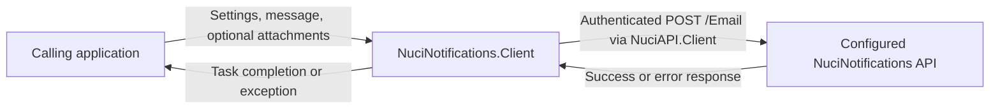
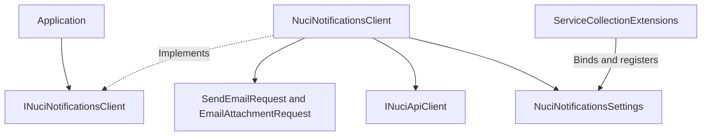
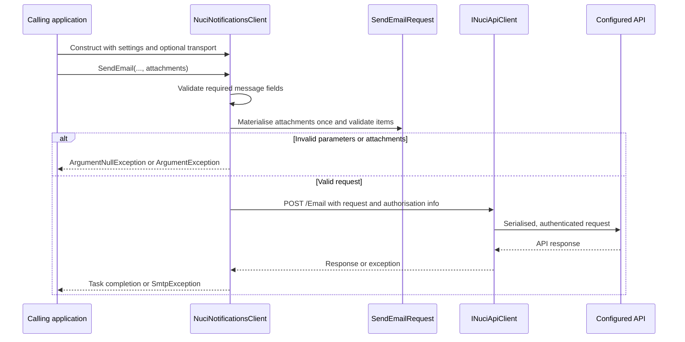
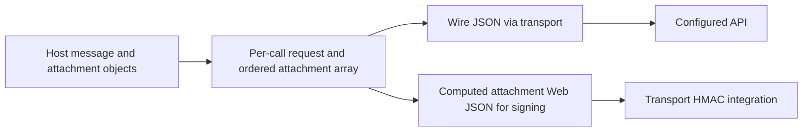
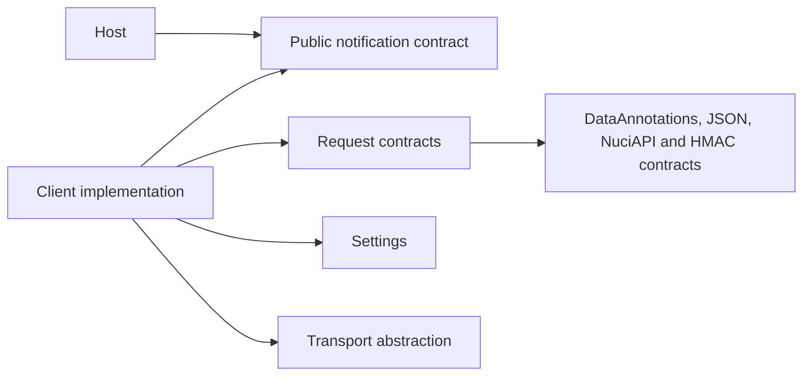

# NuciNotifications.Client Architecture

This document describes the current client-library architecture, including optional e-mail attachments in the working tree. API hosting, message delivery, and server-side storage are external responsibilities.

## 📑 Table of Contents

- [Table of Contents](#-table-of-contents)
- [Purpose](#-purpose)
- [System Context](#-system-context)
- [Architectural Style](#-architectural-style)
- [Runtime Flow](#-runtime-flow)
- [Components](#-components)
- [Data Architecture](#-data-architecture)
- [Interfaces and Integrations](#-interfaces-and-integrations)
- [Cross-Cutting Concerns](#-cross-cutting-concerns)
  - [Security and Privacy](#security-and-privacy)
  - [Error Handling](#error-handling)
  - [Configuration](#configuration)
  - [Concurrency and Resource Use](#concurrency-and-resource-use)
- [Dependency Direction and Rules](#-dependency-direction-and-rules)
- [External Dependencies](#-external-dependencies)
- [Deployment and Operations](#-deployment-and-operations)
- [Compatibility Contracts](#-compatibility-contracts)
- [Testing and Verification](#-testing-and-verification)
- [Design Constraints](#-design-constraints)
- [Extension Points](#-extension-points)
  - [Notification and Transport Implementations](#notification-and-transport-implementations)
- [Source Map](#-source-map)
- [Related Documentation](#-related-documentation)

## 🎯 Purpose

The library provides an asynchronous .NET contract for submitting e-mail notifications. These boundaries assist contributors evaluating changes to validation, signing, transport, and configuration without conflating client submission with server delivery.

## 🌐 System Context

The calling application supplies settings and message data. The library validates and constructs a request, then delegates authenticated HTTP communication to `NuciAPI.Client`. The configured API controls delivery and any subsequent persistence; the library contains no database or file-storage adapter.



The principal external boundaries are:
- **Calling application:** Owns credentials, configuration providers, message content, and attachment bytes.
- **Configured API:** Receives recipient, sender, subject, body, and optional attachments; owns authentication verification and delivery.
- **Transport dependency:** Owns HTTP execution, request serialisation, and HMAC integration outside this repository.

## 🏗️ Architectural Style

This is a library facade with request DTOs and a replaceable transport contract. `INuciNotificationsClient` separates application integration from the concrete implementation; constructor injection of `INuciApiClient` permits a substitute transport, including test mocks.



The principal architecture boundaries are:
- **Public facade:** Exposes three `SendEmail` overloads without exposing HTTP response types.
- **Request contracts:** Define required fields, attachment validation, and HMAC signing order.
- **Transport:** Receives a request and authorisation information; the facade translates transport failures.
- **Composition:** The settings helper registers settings only; the host selects the client registration and lifetime.

## 🔄 Runtime Flow



The principal runtime sequence is:
1. Construct the client with settings and an optional `INuciApiClient`; otherwise construct `NuciApiClient` using `BaseUrl`.
2. Delegate three- and four-argument calls to the five-argument overload, validate required fields, and materialise any attachment enumerable into an ordered array.
3. Validate nested attachments, construct Bearer/HMAC authorisation information, and await `SendRequestAsync` for `POST /Email`.
4. Complete the task on success; translate transport exceptions and unsuccessful API responses to `SmtpException`.

## 🧩 Components

| Component | Responsibility | Principal Dependencies | Lifetime or Ownership |
|-----------|----------------|------------------------|-----------------------|
| `INuciNotificationsClient` | Public asynchronous e-mail contract | Attachment DTO | Implemented or selected by host |
| `NuciNotificationsClient` | Validation, orchestration, response translation | Settings, requests, `INuciApiClient` | Host-controlled lifetime |
| `NuciNotificationsSettings` | `BaseUrl`, `ApiKey`, `HmacSharedSecretKey` | None | Singleton when registered by helper |
| `SendEmailRequest` | Message representation, nested validation, signing content | `NuciApiRequest`, DataAnnotations, JSON, HMAC attributes | Created per call |
| `EmailAttachmentRequest` | File name and Base64 content contract | DataAnnotations | Caller-provided objects |
| `ServiceCollectionExtensions` | Bind named configuration section and register settings | Microsoft configuration/options/DI | Executed during host composition |

## 💾 Data Architecture

Message fields and attachment objects originate in the host. The client copies the enumerable into an array, not a deep copy of its elements. It does not read file paths, persist payloads, or define a server retention period.



| Data or Store | Owner | Representation and Storage | Lifecycle or Consistency |
|---------------|-------|----------------------------|--------------------------|
| `SendEmailRequest` | Client call | In-memory DTO, serialised by transport | Per-call request; no library persistence |
| `Attachments` | Host and request | Ordered array referencing caller-provided DTOs | Null and zero-length arrays are valid; do not mutate during submission |
| `AttachmentsSignatureContent` | Request | Ordered `JsonSerializerOptions.Web` JSON, or zero-length string | Computed from current attachment values; excluded from wire JSON |
| `NuciNotificationsSettings` | Host | In-memory settings captured by client | No built-in credential rotation or storage service |

## 🔌 Interfaces and Integrations

| Interface or Integration | Direction | Contract | Owner | Failure Semantics |
|--------------------------|-----------|----------|-------|-------------------|
| `INuciNotificationsClient.SendEmail` | Inbound | Three, four, or five arguments; returns `Task` | Public facade | Parameter exceptions occur prior to transport |
| `INuciApiClient` | Outbound | `SendEmailRequest`, authorisation info, `POST /Email` | Transport dependency | Exceptions wrapped in `SmtpException`; no client retry |
| `AddNuciNotificationsSettings` | Inbound | `IServiceCollection` and `IConfiguration` | Composition helper | No explicit settings validation |

## 🧵 Cross-Cutting Concerns

### Security and Privacy

Bearer credentials and the shared HMAC secret are supplied via settings. Request properties are signed in this order: sender (1), recipient (2), subject (3), body (4), attachment signature content (5). `Attachments` has `HmacIgnore`; `AttachmentsSignatureContent` has `JsonIgnore`. This contract includes attachment names, contents, and order in the signing input without exposing the computed signing property in wire JSON.

Attachment names require 1-255 characters without slash, backslash, or control characters; contents require non-empty valid Base64. Null elements are invalid. These checks do not provide malware scanning, content-policy enforcement, encryption, or replay protection. HTTPS and practical payload limits are host responsibilities. The library itself contains no logging or telemetry; API error messages and original transport exceptions require protection by callers.

### Error Handling

Null recipient, subject, or body produces `ArgumentNullException`; whitespace-only values produce `ArgumentException`. Invalid nested attachments produce `ArgumentException` with parameter name `attachments` and a generic message. Exceptions raised while enumerating caller input propagate prior to the transport catch. Transport exceptions become `SmtpException` with the original inner exception; unsuccessful responses become `SmtpException` containing the API error message. Retry and rate-limit policy remain with the host.

### Configuration

| Configuration Area | Source | Responsibility | Override or Secret Policy |
|--------------------|--------|----------------|---------------------------|
| `NuciNotificationsSettings` | Host `IConfiguration`, named section, or direct construction | API endpoint, Bearer token, HMAC secret | Host selects providers; helper binds options and registers settings singleton |

### Concurrency and Resource Use

Operations await transport asynchronously, but attachment materialisation and validation are synchronous. No attachment count or byte-size ceiling is enforced. Base64 and signing JSON increase memory requirements. Per-call requests do not establish transport thread safety; host settings and attachment objects remain mutable. Hosts must control concurrent mutation, transport lifetime, and capacity.

## 🧭 Dependency Direction and Rules

Applications depend on the public notification interface. Its implementation depends on request contracts, settings, and the transport abstraction. Request DTOs do not depend on the facade implementation.



The principal dependency rules are:
- Keep message and attachment validation in the facade/request boundary prior to transport.
- Keep server delivery, storage, and application retry policies outside the client library.
- Preserve signing order and JSON exclusions when modifying DTOs.

## 📦 External Dependencies

| Dependency | Responsibility | Integration Boundary | Architectural Consequence |
|------------|----------------|----------------------|---------------------------|
| `NuciAPI.Client` 1.2.4 | HTTP transport and signing integration | `INuciApiClient` | Default implementation can be substituted via constructor |
| `Microsoft.Extensions.DependencyInjection.Abstractions` 10.0.13 | Service registration contracts | Settings registration helper | Host supplies the service container |
| `Microsoft.Extensions.Options.ConfigurationExtensions` 10.0.13 | Bind configuration to options | Settings registration helper | Host owns providers and secret sources |
| `NuciAPI.Requests` and `NuciSecurity.HMAC` | Request base type and signing attributes | Request DTO | Supplied transitively; protocol compatibility requires matching server contract |

## 🚀 Deployment and Operations

The deployment unit is a .NET 10 library package loaded into a host process, not an independently hosted API. Published release workflows package the library for NuGet and GitHub Releases. The host owns startup, shutdown, network access, secret provisioning, and capacity planning.

| Concern | Current Design | Architectural Consequence |
|---------|----------------|---------------------------|
| Process topology | Client executes within host | No independent listener or health endpoint |
| State | Settings and per-call DTOs in memory | No library database migrations or backup procedure |
| Network | Outbound requests to configured API | Configure HTTPS and API availability externally |
| Recovery | No built-in retries | Host controls retry policy and duplicate-delivery risks |

## 🛡️ Compatibility Contracts

| Contract | Owner | Invariant | Verification | Change Policy |
|----------|-------|-----------|--------------|---------------|
| `SendEmail` overloads | Public facade | Existing three/four-argument calls remain; attachments use five arguments | Client and attachment unit tests | Preserve existing call resolution, including null sender |
| `Attachments` | Request DTO | Ordered file-name/Base64 objects; null and zero-length arrays accepted | Attachment validation and round-trip tests | Coordinate changes with API contract |
| `AttachmentsSignatureContent` | Request DTO | Web JSON in array order; zero-length string for absent files; signing-only property excluded from wire JSON | HMAC equivalence and tampering tests | Do not infer compatibility with older server signing contracts |
| `SmtpException` | Client implementation | Transport and API errors retain existing exception translation | Mock transport tests | Preserve distinctions from local argument validation |

## ✅ Testing and Verification

The [unit-test project](NuciNotifications.Client.UnitTests/NuciNotifications.Client.UnitTests.csproj) uses NUnit, FluentAssertions, and Moq. Tests cover public overloads, settings binding, DTO validation, transport invocation, error translation, attachment limits, signing, tampering, and JSON round trips. Mock-based tests do not prove live API delivery, server payload limits, or deployed server compatibility.

Execute the principal automated verification with:

```bash
dotnet test NuciNotifications.Client.slnx
```

## ⚠️ Design Constraints

- **Runtime:** The [library project](NuciNotifications.Client/NuciNotifications.Client.csproj) targets `net10.0`.
- **Server agreement:** Attachments require an API deployment implementing the identical request/signing contract; a minimum server version is not established here.
- **Resources:** No streaming file input, content scanning, or payload-size policy exists in the client.
- **Delivery:** A successful submission does not supply a delivery receipt; no batching, scheduling, or retry mechanism is implemented.

## 🔧 Extension Points

### Notification and Transport Implementations

1. Implement `INuciNotificationsClient` or supply an `INuciApiClient` implementation.
2. Register the notification implementation in the host or pass the transport into the client constructor.
3. Include verification for overload resolution, request ordering, validation, and error translation.

The settings helper does not register a notification client. Substitute implementations must preserve the public asynchronous contract and any required server signing conventions.

## 🗺️ Source Map

| Area | Path |
|------|------|
| Facade and composition | [Client directory](NuciNotifications.Client/) |
| Request contracts | [Requests directory](NuciNotifications.Client/Requests/) |
| Configuration | [Configuration directory](NuciNotifications.Client/Configuration/) |
| Verification | [Unit tests](NuciNotifications.Client.UnitTests/) |

## 📚 Related Documentation

- [README](README.md): installation, usage, and contributor commands.
- [Components](docs/COMPONENTS.md): component-level reference.
- [Execution flows](docs/EXECUTION_FLOWS.md): submission and signing detail.
- [Configuration](docs/CONFIGURATION.md): host configuration examples.
- [Security policy](SECURITY.md): disclosure and security responsibilities.
- [Privacy](PRIVACY.md): message and attachment data processing.